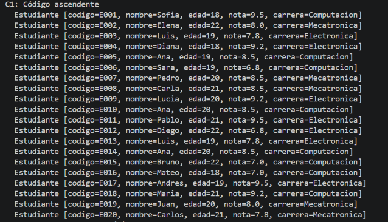
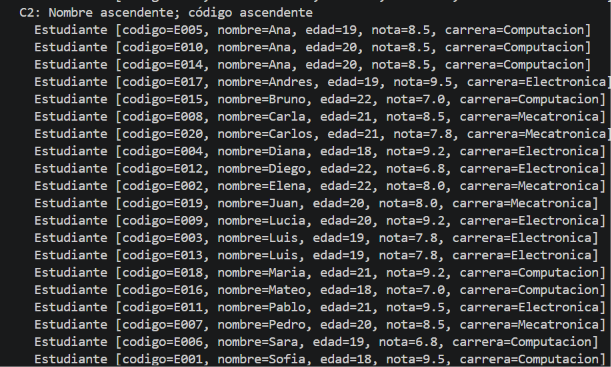
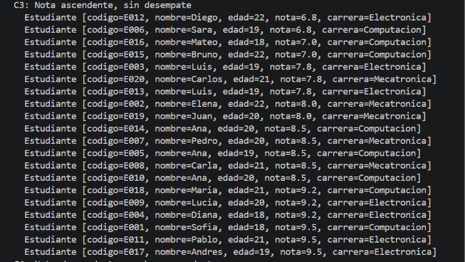
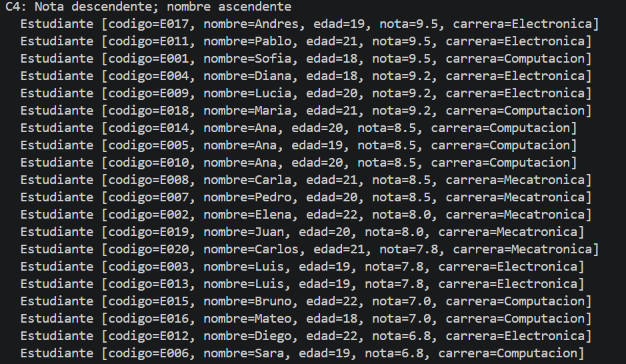
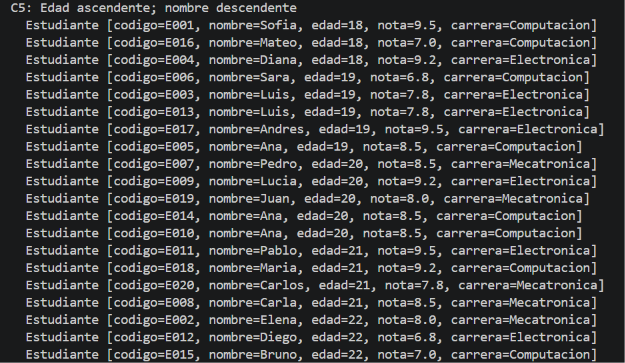
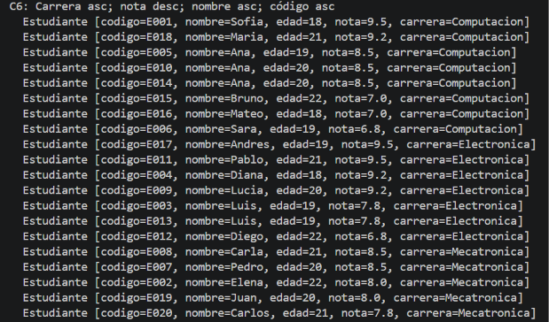
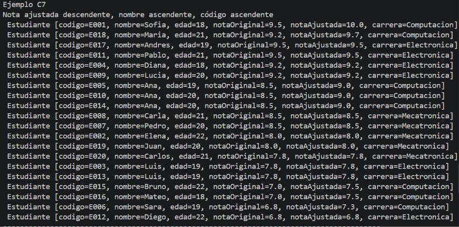
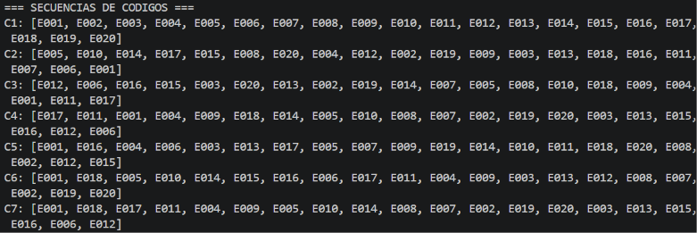
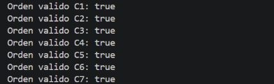
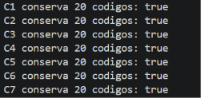

# Evidencias de Ejecución — Práctica PL2.1

- **Autores:** Erick Solis , Roger Macas
- **Carrera:** Ingeniería en Ciencias de la Computación
- **Asignatura:** Estructura de Datos
- **Versión del JDK:** Java 25 (25.0.4.1)

---

## 1. Capturas de ejecución en consola

### Consulta C1 (código ascendente — orden natural)


### Consulta C2 (nombre ascendente; código ascendente + equivalencia lambda vs. referencias)


### Consulta C3 (nota ascendente sin desempate)


### Consulta C4 (nota descendente; nombre ascendente)


### Consulta C5 (edad ascendente; nombre descendente)


### Consulta C6 (carrera asc; nota desc; nombre asc; código asc)


### Consulta C7 (nota ajustada descendente; nombre asc; código asc)


### Secuencias completas de códigos


### Validaciones automáticas


### Casos de prueba y escenarios propios


---

## 2. Resumen de salida real en texto

```text
Equivalencia C2 (lambda vs referencias): true

=== SECUENCIAS DE CODIGOS ===
C1: [E001, E002, E003, E004, E005, E006, E007, E008, E009, E010, E011, E012, E013, E014, E015, E016, E017, E018, E019, E020]
C2: [E005, E010, E014, E017, E015, E008, E020, E004, E012, E002, E019, E009, E003, E013, E018, E016, E011, E007, E006, E001]
C3: [E012, E006, E016, E015, E003, E020, E013, E002, E019, E014, E007, E005, E008, E010, E018, E009, E004, E001, E011, E017]
C4: [E017, E011, E001, E004, E009, E018, E014, E005, E010, E008, E007, E002, E019, E020, E003, E013, E015, E016, E012, E006]
C5: [E001, E016, E004, E006, E003, E013, E017, E005, E007, E009, E019, E014, E010, E011, E018, E020, E008, E002, E012, E015]
C6: [E001, E018, E005, E010, E014, E015, E016, E006, E017, E011, E004, E009, E003, E013, E012, E008, E007, E002, E019, E020]
C7: [E001, E018, E017, E011, E004, E009, E005, E010, E014, E008, E007, E002, E019, E020, E003, E013, E015, E016, E006, E012]
C1 conserva 20 codigos: true
C2 conserva 20 codigos: true
C3 conserva 20 codigos: true
C4 conserva 20 codigos: true
C5 conserva 20 codigos: true
C6 conserva 20 codigos: true
C7 conserva 20 codigos: true
Orden valido C1: true
Orden valido C2: true
Orden valido C3: true
Orden valido C4: true
Orden valido C5: true
Orden valido C6: true
Orden valido C7: true
Estabilidad C3 (nota 8.5): [E014, E007, E005, E008, E010]
Original intacta: true
Lista vacia (tamano): 0
Lista 1 elemento: [E014]
C4 sobre [E014, E005, E010]: [E014, E005, E010]
Caso propio 1 (edad 19 en C5): [E006(Sara), E003(Luis), E013(Luis), E017(Andres), E005(Ana)]
Caso propio 2 (top 4 de C7 - sin bonificacion fuera de Computacion):
  #1 E001 (Computacion) orig=9.5 ajustada=10.0
  #2 E018 (Computacion) orig=9.2 ajustada=9.7
  #3 E017 (Electronica) orig=9.5 ajustada=9.5
  #4 E011 (Electronica) orig=9.5 ajustada=9.5
```

---

## 3. Tabla de pruebas y aceptación

| Escenario | Resultado esperado | Resultado obtenido | Estado |
| :--- | :--- | :--- | :--- |
| C1 con los 20 registros | `E001, E002, …, E020` en orden ascendente | `E001, E002, …, E020` (`Orden valido C1: true`) | Aprobado |
| C2 (lambda y referencias) con 20 registros | Inicia con `E005, E010, E014, E017` y ambas versiones generan la misma secuencia | Inicia con `E005, E010, E014, E017` y `Equivalencia C2: true` | Aprobado |
| C3: estudiantes con nota `8.5` | `E014, E007, E005, E008, E010` conservando su orden relativo original | `[E014, E007, E005, E008, E010]` | Aprobado |
| C4 con los 20 registros | Inicia con `E017, E011, E001` | Inicia con `E017, E011, E001` (`Orden valido C4: true`) | Aprobado |
| C5 con los 20 registros | Inicia con `E001, E016, E004` | Inicia con `E001, E016, E004` (`Orden valido C5: true`) | Aprobado |
| C6 con los 20 registros | Inicia con `E001, E018, E005, E010, E014` | Inicia con `E001, E018, E005, E010, E014` (`Orden valido C6: true`) | Aprobado |
| C7 con los 20 registros | `E001` primero (10.0, original 9.5) y `E018` segundo (9.7, original 9.2) | `E001` (`notaOriginal=9.5, notaAjustada=10.0`) y `E018` (`notaOriginal=9.2, notaAjustada=9.7`) | Aprobado |
| Lista vacía y lista de 1 elemento | Se procesan sin errores y mantienen su contenido | `Lista vacia (tamano): 0` y `Lista 1 elemento: [E014]` | Aprobado |
| C4 sobre `[E014, E005, E010]` | Conserva `E014, E005, E010` por empate total en nota y nombre | `[E014, E005, E010]` | Aprobado |
| Conservación de registros (C1–C7) | Todas las salidas conservan los 20 códigos sin pérdidas ni duplicados | `conserva 20 codigos: true` en `C1` a `C7` | Aprobado |
| Verificación de orden consecutivo (C1–C7) | Todos los pares consecutivos cumplen el criterio de ordenamiento | `Orden valido: true` en `C1` a `C7` | Aprobado |
| Lista original tras todas las consultas | Mantiene los 20 códigos en la secuencia inicial (`E014, E003, …, E013`) | `Original intacta: true` | Aprobado |
| **Caso propio 1:** Empate de edad (`19`) en C5 | Ordena por nombre descendente y preserva el orden relativo de ambos "Luis" (`E003` antes que `E013`) | `[E006(Sara), E003(Luis), E013(Luis), E017(Andres), E005(Ana)]` | Aprobado |
| **Caso propio 2:** Sin bonificación fuera de `Computacion` en C7 | `E017` y `E011` (`Electronica`, nota `9.5`) no reciben `+0.5` y quedan en los puestos `#3` y `#4` | `#3 E017 (orig=9.5, ajustada=9.5)` y `#4 E011 (orig=9.5, ajustada=9.5)` | Aprobado |